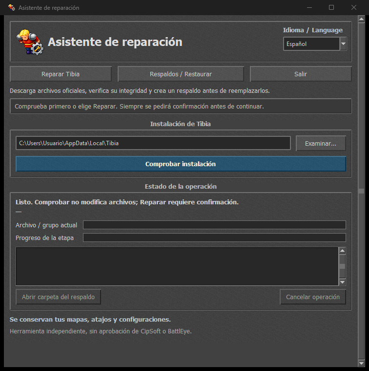

# Asistente de reparación / Repair assistant

**Versión 2 / Version 2 · Portable · Windows x64 · Español / English**

Una herramienta independiente para comprobar, reparar y restaurar archivos de Tibia desde una interfaz gráfica.

An independent graphical tool to check, repair and restore Tibia files.

[Descargar / Download Version 2](https://github.com/davidag29/repair-tibia/releases/tag/v2) · [Español](#espanol) · [English](#english)



<a id="espanol"></a>
## Español

### Descargar y abrir

Descarga **[Repair.Assistant.exe](https://github.com/davidag29/repair-tibia/releases/download/v2/Repair.Assistant.exe)** desde la publicación **Version 2**. Es un único ejecutable portable: no se instala y no necesitas Python. El título de la ventana cambia entre **Asistente de reparación** y **Repair assistant** según el idioma elegido.

La [Versión 1 de terminal](https://github.com/davidag29/repair-tibia/releases/tag/v1) permanece en el historial. Las instrucciones siguientes corresponden a la interfaz gráfica de la Versión 2.

### Comprobar y reparar

1. Abre el programa y elige **Español** o **English** en **Idioma / Language**.
2. Confirma la ruta de Tibia. Si no se encuentra en `%LOCALAPPDATA%\Tibia`, escribe otra carpeta o usa **Examinar**. También puedes indicar la ruta de `Tibia.exe`.
3. **Comprobar instalación** consulta los manifiestos oficiales y verifica los archivos locales sin reemplazarlos. Muestra los archivos pendientes y el tamaño estimado de descarga.
4. **Reparar Tibia** espera a que cierres el juego y su iniciador normalmente. La ventana permanece abierta y continúa automáticamente; no fuerza su cierre.
5. Después de comprobar la instalación, aparece una confirmación con los archivos pendientes, descarga estimada y ubicación del respaldo. **No** es la opción predeterminada. También se sincronizan los metadatos oficiales.
6. Al aceptar, descarga y verifica todo, crea el respaldo, reemplaza archivos y verifica el resultado. Si Tibia se vuelve a abrir, espera, vuelve a comprobar y solicita una nueva confirmación para el plan actualizado.
7. Al finalizar, abre Tibia desde tu acceso directo habitual.

Si archivos y metadatos ya están actualizados, no crea cambios ni otro respaldo. El registro indica el resultado y las barras muestran el avance real de la etapa y del archivo o grupo actual.

**Cancelar operación** detiene esperas, lecturas y descargas en puntos seguros. Durante la instalación, restauración o recuperación se deshabilita para terminar el trabajo antes de cerrar. Si solicitas salir durante esa etapa, la ventana espera. No fuerces el cierre del proceso.

### Respaldos y restauración

Los respaldos se guardan **junto a la carpeta de instalación**, con este formato:

```text
%LOCALAPPDATA%\Tibia-respaldo-AAAAMMDD-HHMMSS-identificador
```

Si Tibia está en `D:\Juegos\Tibia`, quedan en `D:\Juegos\Tibia-respaldo-*`. **Abrir carpeta del respaldo** abre la ubicación exacta.

Cada respaldo contiene los archivos que iban a reemplazarse y `restore.json`; no es una copia completa de Tibia. Se conservan los respaldos creados por las versiones anteriores y se admite su restauración.

1. Selecciona la misma instalación de Tibia que se reparó.
2. Abre **Respaldos / Restaurar** y elige un respaldo. **Buscar otra carpeta** permite localizarlo manualmente.
3. Confirma la restauración; **No** es la opción predeterminada.
4. El programa espera al cierre de Tibia y verifica todos los archivos del respaldo antes de escribir.

Restaurar recupera archivos anteriores y elimina los que creó aquella reparación. Puede devolver el cliente a una versión antigua. **El respaldo se conserva** después de restaurar.

### Si algo falla

- Si falla una descarga o su verificación, no comienza a reemplazar archivos de la instalación.
- Si falla la instalación después de empezar a escribir, intenta recuperar los archivos modificados desde el respaldo.
- Si la recuperación queda incompleta, la ventana permanece abierta y el registro muestra los archivos pendientes y la ubicación del respaldo. Resuelve el bloqueo o los permisos y vuelve a **Respaldos / Restaurar**.
- Una restauración incompleta conserva el respaldo para reintentar. No borres esa carpeta.
- La recuperación automática cubre errores detectados por el programa; no implica que pueda recuperarse automáticamente después de un cierre forzado o un corte eléctrico. En esos casos, conserva el respaldo y usa Restaurar.

### Archivos oficiales, permisos y compatibilidad

Las descargas proceden de `https://static.tibia.com/launcher/`, con consultas para evitar información antigua en caché. Se comprueban tamaños y SHA-256, incluida la envoltura LZMA de Tibia, y se verifica que los manifiestos del servidor no hayan cambiado antes de instalar.

Se conservan mapas, atajos, configuraciones, capturas y demás carpetas personales protegidas. No modifica la memoria del juego ni desactiva BattlEye. Es una herramienta independiente, sin aprobación de CipSoft o BattlEye; no garantiza resolver todas las causas del fallo de actualización ni ausencia de incompatibilidades.

Se ejecuta con los permisos del usuario. **No solicita administrador automáticamente**; si Windows deniega acceso, muestra el error. **No tiene firma digital Authenticode**. La publicación incluye el SHA-256 del ejecutable para comprobar la descarga.

**Windows 11 x64 probado localmente.** Windows 10 x64 no se ha validado en otro equipo. No se ofrece compatibilidad con Windows 7/8/8.1, 32 bits ni ARM64. Las pruebas de distribución todavía requieren más equipos; retirar Python del PATH en una prueba no equivale a probar todas las instalaciones de Windows.

Si Windows bloquea el archivo, consulta la [guía de Control de aplicaciones de Windows](docs/windows-app-control.md#espanol). Desactivar las protecciones no es un requisito del funcionamiento previsto. Para una detección incorrecta, se puede solicitar revisión al fabricante del antivirus.

<a id="english"></a>
## English

### Download and open

Download **[Repair.Assistant.exe](https://github.com/davidag29/repair-tibia/releases/download/v2/Repair.Assistant.exe)** from **Version 2**. It is one portable executable: no installer and no Python installation required. The window title switches between **Asistente de reparación** and **Repair assistant** with the selected language.

The [Version 1 terminal edition](https://github.com/davidag29/repair-tibia/releases/tag/v1) remains available in the release history. These instructions describe Version 2's graphical interface.

### Check and repair

1. Select **Español** or **English** under **Idioma / Language**.
2. Check the Tibia path. If it is not found at `%LOCALAPPDATA%\Tibia`, enter another folder or use **Browse**. A path to `Tibia.exe` is also accepted.
3. **Check installation** requests official manifests and verifies local files without replacing them. It reports pending files and estimated download size.
4. **Repair Tibia** waits for you to close the game and launcher normally. The window stays open and continues automatically; processes are not forcibly closed.
5. After checking, a confirmation shows pending files, estimated download and backup location. **No** is the default. Official metadata is synchronized too.
6. On confirmation, all downloads are verified, files are backed up, then replaced and verified. If Tibia reopens, the tool waits, rescans and asks for confirmation again for the refreshed plan.
7. When finished, start Tibia from your usual shortcut.

If files and metadata are already current, no changes or additional backups are created. The log reports results; progress bars show actual stage and current file/group progress.

**Cancel operation** stops waits, reads and downloads at safe points. Cancellation is disabled during installation, restoration and recovery so the operation can finish before closing. A close request waits for completion. Do not forcibly terminate the process.

### Backups and restoration

Backups are stored **beside the Tibia installation folder**:

```text
%LOCALAPPDATA%\Tibia-respaldo-YYYYMMDD-HHMMSS-identifier
```

For `D:\Games\Tibia`, backups are placed in `D:\Games\Tibia-respaldo-*`. **Open backup folder** opens the exact location.

Each backup contains files that were about to be replaced and `restore.json`; it is not a complete installation backup. Backups from earlier releases remain compatible.

1. Select the same Tibia installation that was repaired.
2. Open **Backups / Restore** and select a backup, or **Browse another folder**.
3. Confirm restoration; **No** is the default.
4. The tool waits for Tibia to close and verifies every backup file before writing.

Restoration recovers previous files and removes files created by that repair. It can revert the client to an older version. **Backups are retained** after restoration.

### If something fails

- Download or verification failures stop before installation files are replaced.
- An installation failure triggers an attempt to recover modified files from the backup.
- Incomplete recovery keeps the window open and lists pending files and the backup location. Resolve locks or permissions, then retry **Backups / Restore**.
- Incomplete restoration retains the backup for retries. Do not delete it.
- Automatic recovery covers errors detected by the running application. It does not promise automatic recovery after forced termination or power loss; retain the backup and use Restore in those cases.

### Official files, permissions and compatibility

Files come from `https://static.tibia.com/launcher/`, using queries to avoid stale cached information. Downloads are checked against size and SHA-256, including Tibia's LZMA wrapper. Server manifests are rechecked before installation.

Maps, hotkeys, settings, screenshots and protected personal folders are preserved. The tool does not modify game memory or disable BattlEye. It is independent and not approved by CipSoft or BattlEye; it cannot guarantee a fix for every update failure or freedom from incompatibilities.

The app uses the current user's permissions. **It does not request administrator access automatically**; denied access is reported. **It is not Authenticode-signed**. The release includes the executable's SHA-256 for download verification.

**Windows 11 x64 tested locally.** Windows 10 x64 has not been validated on another computer. Windows 7/8/8.1, 32-bit and ARM64 are not supported targets. Broader distribution testing is still needed; removing Python from PATH is not equivalent to testing every Windows installation.

If Windows blocks it, see the [Windows App Control guide](docs/windows-app-control.md#english). Disabling protections is not required for intended operation. Incorrect antivirus detections can be submitted to the vendor for review.

## Código fuente y compilación / Source and build

Python 3.14 x64 was used for the Windows build. Tkinter/Tcl/Tk must be available in the development installation. End users only need the release EXE.

```powershell
# Interfaz gráfica / Graphical application
python src/srepair_gui.py

# EXE portable sin consola / Portable windowed EXE
.\build.ps1
```

Output: `dist/Repair Assistant.exe`. The build uses pinned PyInstaller, `--onefile --windowed --noupx`, includes the icon and Tcl/Tk, and does not apply a digital signature. `build-preview.ps1` is a compatibility alias for the same graphical build.

The legacy terminal interface remains available **from source**, with its original command-line options:

```powershell
python src/srepair.py --help
python src/srepair.py --language es --diagnose
python src/srepair.py --language en --menu
```

These options belong to the source terminal entry point; they are not command-line options of the graphical release EXE.

## Pruebas / Tests

```powershell
python tests/test_repair.py
python -m unittest discover -s tests -p test_diagnostic.py
python -m unittest discover -s tests -p test_gui.py
python -m unittest discover -s tests -p test_gui_workflows.py
```

GUI tests require a Windows desktop session. They exercise actual repair and restoration with temporary installations and a simulated official server, including corrupt downloads, rejected confirmation, cancellation, changed manifests, stale metadata, write failures, incomplete recovery, reopening the game and backup validation. Existing terminal recovery tests are retained. Tk scaling checks cover layouts at relative 100%, 125% and 150%; they do not replace testing on other physical devices.

## Estructura / Structure

- `src/srepair_gui.py`: Tkinter/ttk interface, worker thread and event queue.
- `src/srepair.py`: shared repair engine and legacy terminal interface.
- `packaging/`: Windows version metadata and embedded application icon.
- `tests/`: diagnostic, interface, repair and recovery tests.
- `docs/`: Windows App Control guide, screenshots and [icon origin / generation prompt](docs/icon-source.md).

La textura de piedra se genera en el código. El icono deriva del recurso local del cliente de Tibia con un símbolo de reparación añadido; los elementos originales de Tibia pertenecen a sus respectivos titulares.

The stone texture is generated in code. The icon derives from the local Tibia client's resource with an added repair symbol; original Tibia elements belong to their respective owners.
