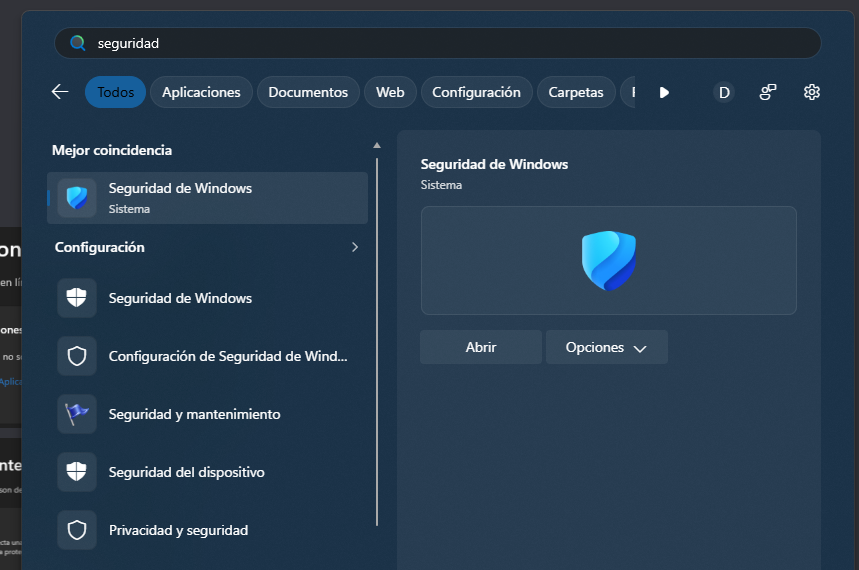
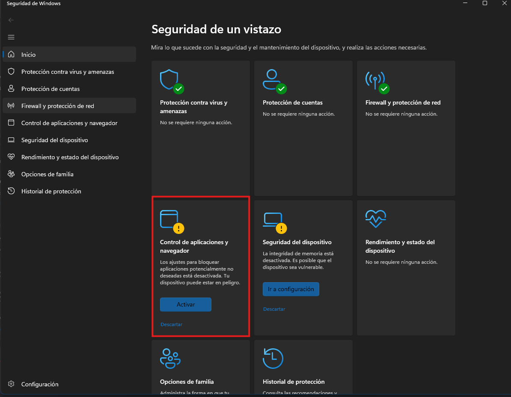
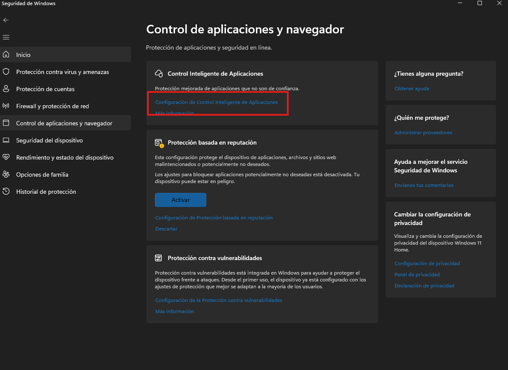
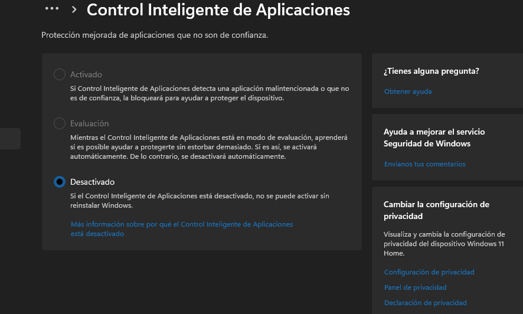

# Si Windows bloquea la aplicación / If Windows blocks the app

[Español](#espanol) | [English](#english) | [Volver al README / Back to README](../README.md)

<a id="espanol"></a>
## Español

Si tienes problemas con **Control inteligente de aplicaciones de Windows (Smart App Control)**, sigue estos pasos para localizar y revisar su configuración. Las capturas muestran dónde están los ajustes; no incluyen el mensaje de bloqueo original ni demuestran que un archivo sea seguro.

Esta guía corresponde a **Smart App Control en Windows 11**. Si el aviso identifica SmartScreen, Microsoft Defender, una amenaza concreta o una política de tu organización, comparte ese mensaje exacto en [Issues](https://github.com/davidag29/repair-tibia/issues/new): puede requerir una solución distinta.

### Antes de cambiar la configuración

El Asistente de reparación **no tiene firma digital Authenticode**. Microsoft indica que Smart App Control no ofrece una excepción para una sola aplicación y puede bloquear código desconocido sin firma. [FAQ de Microsoft](https://support.microsoft.com/en-us/windows/security/threat-malware-protection/smart-app-control-frequently-asked-questions).

Descarga el programa únicamente desde [las versiones de este repositorio](https://github.com/davidag29/repair-tibia/releases) y compara su SHA-256 con el publicado en la versión correspondiente:

```powershell
Get-FileHash -LiteralPath '.\Repair.Assistant.exe' -Algorithm SHA256
```

La coincidencia del hash identifica la copia publicada; no sustituye un análisis de seguridad ni una firma digital.

### 1. Abre Seguridad de Windows

En Inicio, busca **seguridad** y abre **Seguridad de Windows**.



### 2. Abre Control de aplicaciones y navegador

Selecciona la tarjeta **Control de aplicaciones y navegador**, indicada en rojo, o la opción del mismo nombre en la barra lateral. Los avisos de otras tarjetas que aparecen en esta captura no forman parte de estos pasos.



### 3. Abre la configuración de Control inteligente de aplicaciones

Selecciona **Configuración de Control Inteligente de Aplicaciones**.



### 4. Revisa el estado y decide si quieres cambiarlo

Comprueba el estado y lee el aviso que muestra **tu equipo**. La siguiente captura es una referencia con **Desactivado** seleccionado; no significa que todos deban dejarlo así para usar el reparador.



**Si decides desactivar esta protección para intentar ejecutar la aplicación**, selecciona **Desactivado** y lee la confirmación de Windows antes de aceptarla. El cambio es global: afecta a otras aplicaciones del equipo, no solo al Asistente de reparación. Es una decisión manual del propietario del equipo, no un paso que ejecute el reparador. Si no deseas reducir esa protección, conserva el estado actual y no ejecutes esta versión.

La captura indica que se necesita reinstalar Windows para reactivarlo en esa instalación. **No es una regla universal para todos los equipos actuales:** Microsoft documenta que actualizaciones recientes permiten reactivarlo sin reinstalar en equipos compatibles; ciertas configuraciones aún pueden requerir restablecer o reinstalar Windows. Consulta el aviso local y la [FAQ vigente](https://support.microsoft.com/en-us/windows/security/threat-malware-protection/smart-app-control-frequently-asked-questions) antes de cambiarlo.

Si la opción para activarlo aparece atenuada, revisa Windows Update y las instrucciones oficiales para tu versión. Microsoft publicó una corrección para un problema de reactivación en Windows 11 25H2 y 26H2 en [KB5127936](https://support.microsoft.com/en-us/servicing/os/windows-11/2026/10/kb5127936-windows-11-25h2-26h2-update). Esto no garantiza que ese sea el motivo en tu equipo.

Estos pasos no requieren desactivar Microsoft Defender, el firewall ni la integridad de memoria. No recomendamos cambiar otros controles para seguir esta guía. En un equipo administrado, consulta al responsable de sistemas.

### Si continúa el bloqueo

Publica un reporte en [Issues](https://github.com/davidag29/repair-tibia/issues/new) con la versión de Windows, la versión del reparador, el texto exacto del aviso y una captura sin datos personales. Si el antivirus identifica una amenaza, solicita la revisión del archivo al fabricante antes de intentar ejecutarlo. Microsoft dispone de un [portal para revisar detecciones](https://www.microsoft.com/en-us/wdsi/filesubmission).

Para distribución, el proyecto sigue pendiente de contar con una firma de código válida. Esta guía no certifica la seguridad del ejecutable ni su compatibilidad con BattlEye.

<a id="english"></a>
## English

If you have trouble with **Windows Smart App Control**, follow these steps to locate and review its settings. The screenshots show where the settings are; they do not include the original block message or prove that a file is safe. The screenshots use the Spanish Windows interface; English labels are provided below.

This guide applies to **Smart App Control on Windows 11**. If the message names SmartScreen, Microsoft Defender, a specific threat or an organizational policy, share the exact message in [Issues](https://github.com/davidag29/repair-tibia/issues/new): a different solution may be needed.

### Before changing settings

The Repair assistant executable **is not Authenticode-signed**. Microsoft states that Smart App Control has no per-app exception and may block unknown unsigned code. [Microsoft FAQ](https://support.microsoft.com/en-us/windows/security/threat-malware-protection/smart-app-control-frequently-asked-questions).

Download only from [this repository's releases](https://github.com/davidag29/repair-tibia/releases) and compare the SHA-256 with the one published for that release:

```powershell
Get-FileHash -LiteralPath '.\Repair.Assistant.exe' -Algorithm SHA256
```

A matching hash identifies the published copy; it does not replace a security review or digital signature.

### 1. Open Windows Security

Search for **Windows Security** in Start and open it. The screenshot shows the Spanish search term **seguridad** and the app **Seguridad de Windows**.


### 2. Open App & browser control

Select **App & browser control** (**Control de aplicaciones y navegador**), highlighted in red, or its sidebar entry. Warnings on other cards in this screenshot are not part of these steps.


### 3. Open Smart App Control settings

Select **Smart App Control settings** (**Configuración de Control Inteligente de Aplicaciones**).


### 4. Review the state and decide whether to change it

Check the state and read the notice shown on **your device**. The screenshot below is a reference with **Off** (**Desactivado**) selected; it is not a requirement for every user of the repair tool.


**If you decide to turn this protection off to try running the application**, select **Off** and read the Windows confirmation before accepting it. This is a global change affecting other apps, not just Repair assistant. It is a manual decision by the device owner, not an action performed by this tool. If you do not want to reduce that protection, keep the current setting and do not run this release.

This screenshot says that reinstalling Windows is required to turn it back on for that installation. **That is not universal for current devices:** Microsoft documents that recent updates allow re-enabling it without reinstalling on eligible devices; some configurations can still require resetting or reinstalling Windows. Read your local notice and the [current FAQ](https://support.microsoft.com/en-us/windows/security/threat-malware-protection/smart-app-control-frequently-asked-questions) before changing it.

If the option to turn it on is grayed out, check Windows Update and the official guidance for your version. Microsoft published a fix for a re-enabling issue on Windows 11 25H2 and 26H2 in [KB5127936](https://support.microsoft.com/en-us/servicing/os/windows-11/2026/10/kb5127936-windows-11-25h2-26h2-update). That does not guarantee the same issue applies to your device.

These steps do not require disabling Microsoft Defender, the firewall or memory integrity. We do not recommend changing other controls to follow this guide. On a managed device, consult your administrator.

### If the block continues

Open an [issue](https://github.com/davidag29/repair-tibia/issues/new) with your Windows version, repair-tool version, exact message and a screenshot without personal information. If antivirus software identifies a threat, ask its vendor to review the file before attempting to run it. Microsoft provides a [file-review portal](https://www.microsoft.com/en-us/wdsi/filesubmission).

The project still needs a valid code-signing certificate for distribution. This guide does not certify the executable's safety or compatibility with BattlEye.
